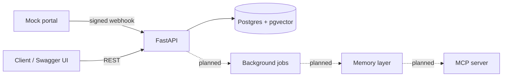

# ClinicMind

A CRM for dental and skin clinic enquiries, with an **AI memory layer**, **third-party integrations** and **MCP tools** for agents.

> **Status:** work in progress. Week 1 (backend foundation and secure webhooks) is complete. Everything marked "Planned" is not built yet.
> All data in this project is synthetic. No real patient information is used.

## Why this exists

Clinic front desks lose context across WhatsApp, email and calls ("afraid of needles", "budget ₹60k", "only free in the evening"). ClinicMind keeps that context in one place and will remember it for AI agents.

## What works today

- Leads CRUD with per-org scoping and duplicate-email protection
- Conversation threads and messages per lead, with channel and direction
- **Signed webhook ingestion** from a mock clinic-directory portal:
  - HMAC-SHA256 signature on the exact raw request body
  - Timestamp check against replay attacks (5-minute window)
  - Idempotency via a unique `(provider, event_id)` constraint
  - Raw events stored with a status, so failed events are never lost
- Alembic migrations and an automated test suite (pytest)

## Architecture



## Tech stack

Python 3.12, FastAPI, SQLAlchemy 2, Alembic, PostgreSQL 16 with pgvector, Docker Compose, pytest.

## Run it locally (Windows PowerShell)

```powershell
git clone https://github.com/Manha27/clinicmind.git
cd clinicmind
python -m venv .venv
.venv\Scripts\Activate.ps1
pip install -r requirements.txt
copy .env.example .env        # then put a random value for WEBHOOK_SECRET
docker compose up -d
alembic upgrade head
python -m app.seed
uvicorn app.main:app --reload
```

Open http://127.0.0.1:8000/docs for the interactive API.

Send a signed test webhook:

```powershell
python -m scripts.send_webhook
```

## Run the tests

```powershell
docker exec -it clinicmind-db psql -U clinicmind -d clinicmind -c "CREATE DATABASE clinicmind_test;"
python -m pytest -v
```

## Roadmap

- [x] Week 1: schema, CRUD, signed webhooks, tests
- [ ] Week 2: LLM wrapper with cost/latency logging, structured fact extraction, embeddings
- [ ] Week 3: memory reconcile (add/update/supersede), hybrid retrieval, context builder
- [ ] Week 4: Gmail OAuth sync, Slack alerts, background jobs with retries
- [ ] Week 5: agent tool loop and MCP server
- [ ] Week 6: evals (full history vs summary vs memory retrieval), forgetting and decay
- [ ] Week 7: memory viewer UI, demo video