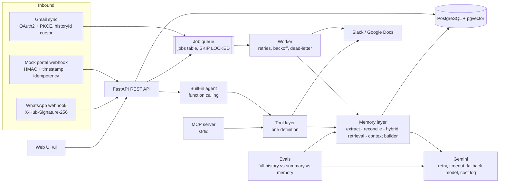

# Architecture

## Design decisions worth explaining

**Jobs live in Postgres.** One less service to run, jobs are created in the same transaction as the data that caused them, and `FOR UPDATE SKIP LOCKED` lets several workers pull jobs without running one twice. A partial unique index (`WHERE status='queued'`) deduplicates: ten messages arriving together produce one extraction job, but a message arriving while a job is *running* still queues a new one, so nothing is missed.

**Memory is never silently overwritten.** A changed fact (budget 60k -> 80k) marks the old memory `superseded` with a validity window and a link to its replacement. Retrieval only sees `active` memories; the audit table records every ADD / SUPERSEDE / NOOP with the reason.

**Reconcile avoids LLM calls where it can.** Near-identical memories (cosine similarity >= 0.97) are skipped, unrelated ones (< 0.70) are added, and only the ambiguous middle goes to a small LLM call. Unusable LLM output falls back to ADD: a stray duplicate costs less than a lost fact.

**Retrieval is hybrid.** `0.55*vector + 0.20*keyword + 0.15*recency + 0.10*importance`, returned with a per-part breakdown. The weights are starting guesses; the evals are how they should be tuned.

**One tool layer.** `app/tools.py` defines each tool once (Pydantic input, safety flags). The built-in agent and the MCP server both call `run_tool`. Tools that act outside the system (Slack, Google Docs) do nothing unless a *human* has approved (`allow_external`); the model's own `confirm=true` is not enough.

**Third-party calls share one HTTP helper.** Retries on 429/5xx/network errors, `Retry-After` honoured, exponential backoff with jitter, a client-side throttle. A permanent failure (revoked token, revoked webhook URL) goes straight to the dead-letter state instead of retrying pointlessly.

**OAuth tokens are encrypted at rest** (Fernet), the login uses `state` (CSRF) and PKCE, and the access token is refreshed automatically; a revoked refresh token marks the account `needs_reauth`.

**Evals are deterministic.** Answers are scored by matching normalised values (`80k` = `80,000` = `0.8 lakh`), with explicit "stale value" and "must abstain" checks. No LLM judge, so runs are reproducible and re-scoring is free.

## Known limitations

- Gmail sync only keeps emails from people who are already leads (by design, for privacy).
- Only text WhatsApp messages are read; other types are stored as placeholders.
- Retrieval weights and similarity thresholds are untuned defaults.
- The eval set is small (8 patients, 48 questions): it shows direction, not statistical proof.
- The UI has no login; this is a single-organisation demo.
